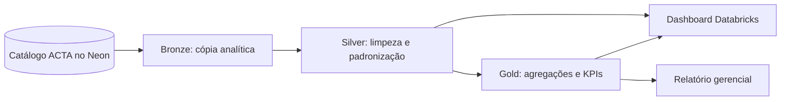

# 📊 ACTA BI

Camada analítica do ACTA para acompanhar a execução dos ciclos PDCA por meio de indicadores, tendências e recortes operacionais.

## 📌 Visão geral

O `acta-bi` reúne notebooks SQL para transformar dados do ACTA no Databricks e um dashboard exportado para análise gerencial. A origem esperada é o catálogo `neon_db_acta_catalog`, com objetos dos schemas `public`, `pdca` e `auditoria`. O fluxo organiza os dados em camadas Bronze, Silver e Gold; o dashboard consulta principalmente as views Gold e uma consulta Silver de ciclos e usuários.

O repositório também mantém o [Relatório Gerencial do ACTA](docs/Relat%C3%B3rio%20Gerencial%20-%20ACTA.pdf), que apresenta a análise e os indicadores do projeto.

## ✨ Capacidades

| Área | Capacidades |
| --- | --- |
| Ingestão analítica | Materializa no schema Bronze dimensões e fatos de usuários, empresas, ciclos, tarefas, planos de ação, treinamentos, alertas, auditoria e atividade. |
| Tratamento | Deduplica registros, remove linhas sem identificadores essenciais, seleciona colunas analíticas e normaliza campos como título, cidade e UF na camada Silver. |
| Indicadores | Consolida tarefas concluídas, em andamento, atrasadas e bloqueadas; taxas de conclusão, atraso e bloqueio; execução de treinamentos; metas e desempenho por ciclo, empresa, usuário e estado. |
| Dashboard | Apresenta cartões de indicadores, evolução temporal, comparações por setor, distribuição em histograma, mapas por estado, tabelas, filtros e visão de tarefas por usuário. |
| Orquestração | O relatório registra o Job `acta-job`, a tarefa `exec_pipeline_acta` e a pipeline `acta-pipeline`, com execução diária no Databricks. |
| Relatório gerencial | Apresenta a análise da base, do problema, do tratamento e dos indicadores, com evidências do Job em PDF. |

## 🛠️ Tecnologias

| Tecnologia | Uso |
| --- | --- |
| Databricks SQL | Leitura, tratamento e materialização de views analíticas. |
| Neon PostgreSQL | Fonte relacional consultada pelo catálogo `neon_db_acta_catalog`. |
| Databricks AI/BI Dashboards | Dashboard exportado em [`dashboards/acta-dashboards.lvdash.json`](dashboards/acta-dashboards.lvdash.json). |
| Jupyter Notebook | Formato versionado para os notebooks SQL do pipeline. |

## ✅ Pré-requisitos

- Acesso a um workspace Databricks com suporte aos comandos SQL e às views materializadas usados nos notebooks.
- Catálogo `neon_db_acta_catalog` configurado e acessível, com os schemas e objetos de origem referenciados no notebook Bronze.
- Permissões para ler as tabelas de origem e criar ou atualizar views nos schemas `workspace.bronze`, `workspace.silver` e `workspace.gold`.
- Dashboard Databricks com acesso às views das camadas Silver e Gold usadas como fontes.

Os nomes de catálogo, schema e objetos precisam corresponder aos usados nos arquivos. Credenciais e configurações de conexão pertencem ao workspace; não as salve nos notebooks nem neste repositório.

## 🚀 Fluxo de execução

Os notebooks são SQL e dependem das camadas anteriores. Importe-os no workspace Databricks e execute-os nesta ordem:

1. [`bronze.ipynb`](notebooks/acta-pipeline/transformations/bronze.ipynb): lê dimensões, fatos e tabelas de atividade do catálogo de origem e atualiza as views Bronze.
2. [`silver.ipynb`](notebooks/acta-pipeline/transformations/silver.ipynb): aplica deduplicação, filtros de identificadores nulos, seleção e normalização de campos, gerando as views Silver.
3. [`gold.ipynb`](notebooks/acta-pipeline/transformations/gold.ipynb): agrega os dados Silver e materializa os indicadores e recortes consumidos pelo dashboard.

O dashboard está versionado em [`acta-dashboards.lvdash.json`](dashboards/acta-dashboards.lvdash.json). Importe o arquivo no workspace e confirme que as fontes `workspace.gold.*` e a consulta Silver de ciclos e usuários estão disponíveis. Após atualizar as camadas, atualize os dados do dashboard no Databricks.



O relatório gerencial documenta o Job `acta-job`, que executa diariamente a tarefa `exec_pipeline_acta`, vinculada à pipeline `acta-pipeline`. Ele inclui evidências de configuração e do histórico, com execuções bem-sucedidas registradas entre 17 e 25 de outubro de 2026. A definição do Job é mantida no workspace Databricks, não como arquivo de configuração neste repositório; consulte o workspace para verificar o estado atual.

## 📊 Indicadores e visualizações

As views Gold calculam, entre outros, totais e taxas de conclusão, atraso e bloqueio de tarefas; taxas de conclusão de planos e alcance de metas por ciclo; realização de treinamentos; tarefas bloqueadas; atividade diária por empresa; e indicadores por estado e usuário. Percentuais são arredondados para duas casas decimais e divisões por zero são protegidas com `NULLIF`.

O dashboard exportado possui páginas de visão geral, desempenho por setor, atrasos e riscos, visão por empresa e visão por usuário. Inclui cartões de KPI, gráficos de linha e barras, histograma da taxa de conclusão por empresa, mapas coropléticos por estado, tabela, gráfico Gantt e filtros de período, empresa e usuário. O relatório explica a escolha do histograma em vez de boxplot por haver poucos registros por empresa e setor; também apresenta desvios padrão no texto para manter os cards legíveis.

Os filtros e visuais refletem a configuração exportada. Sua disponibilidade e os valores exibidos dependem das views atualizadas e das permissões do workspace Databricks.

## 📄 Relatório gerencial

O documento [`Relatório Gerencial - ACTA.pdf`](docs/Relat%C3%B3rio%20Gerencial%20-%20ACTA.pdf) complementa o dashboard com a análise da base, o problema analisado, o tratamento dos dados, os KPIs e evidências do Job no Databricks. Os dados do relatório têm caráter ilustrativo; nomes e valores não devem ser interpretados como dados reais da operação do ACTA.

## 🏗️ Arquitetura e estrutura

```text
.
├── dashboards/
│   └── acta-dashboards.lvdash.json
├── docs/
│   └── Relatório Gerencial - ACTA.pdf
└── notebooks/
    └── acta-pipeline/
        └── transformations/
            ├── bronze.ipynb
            ├── silver.ipynb
            └── gold.ipynb
```

- `notebooks/acta-pipeline/transformations/`: etapas SQL de ingestão, tratamento e agregação.
- `dashboards/`: definição exportada do dashboard e das fontes visuais.
- `docs/`: relatório gerencial em PDF.

## 🤝 Links e autoria

- [Repositório](https://github.com/AppActa/acta-bi) · [Licença MIT](LICENSE) · `acta.institutojef@gmail.com`
- Integrações: [ACTA Database](https://github.com/AppActa/acta-database).
- Contribuições: use *issues* e *pull requests*; há um [PULL_REQUEST_TEMPLATE.md](PULL_REQUEST_TEMPLATE.md).